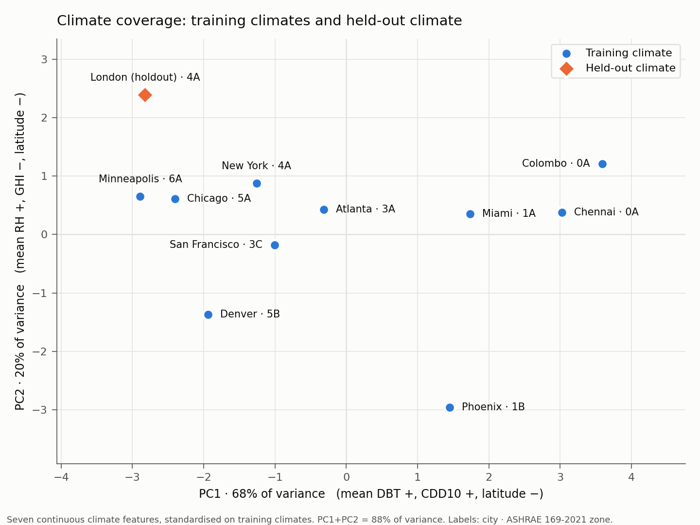

# Climate Coverage Report — Sub-task 2.3.6

*Generated by `climate/coverage_report.py` from `climate/climate_metadata.csv` (sha256 `5cd50b6244329005…`). Do not edit by hand — rerun the script.*

Training climates: **10** · held-out: **1** · features: **7 continuous** · data: SRC-TMYx 2011-2025

## 1. Climate features

| Climate | Role | Zone | HDD18 (°C·day) | CDD10 (°C·day) | GHI (kWh/m²) | mean DBT (°C) | mean RH (%) | latitude (°) | mean wind (m/s) |
|---|---|---|---|---|---|---|---|---|---|
| Atlanta | training | 3A | 1,295 | 3,189 | 1,652 | 17.90 | 67.12 | 33.63 | 3.54 |
| Chennai | training | 0A | 0 | 6,941 | 1,906 | 29.02 | 73.18 | 12.99 | 2.77 |
| Chicago | training | 5A | 3,124 | 1,938 | 1,520 | 11.21 | 66.57 | 41.96 | 4.48 |
| Colombo | training | 0A | 0 | 6,527 | 1,879 | 27.88 | 79.87 | 6.90 | 1.39 |
| Denver | training | 5B | 2,979 | 1,773 | 1,877 | 11.37 | 49.67 | 39.83 | 4.45 |
| Miami | training | 1A | 41 | 5,667 | 1,806 | 25.52 | 72.26 | 25.76 | 3.26 |
| Minneapolis | training | 6A | 3,903 | 1,779 | 1,478 | 8.93 | 64.09 | 44.88 | 4.14 |
| New York | training | 4A | 2,342 | 2,192 | 1,484 | 13.60 | 63.87 | 40.78 | 2.44 |
| Phoenix | training | 1B | 490 | 5,337 | 2,140 | 24.58 | 33.22 | 33.43 | 2.90 |
| San Francisco | training | 3C | 1,284 | 1,764 | 1,870 | 14.80 | 70.89 | 37.62 | 4.64 |
| London | holdout | 4A | 2,430 | 1,119 | 1,152 | 11.54 | 79.70 | 51.15 | 3.76 |

## 2. Feature correlation (training climates)

| | HDD18 | CDD10 | GHI | mean DBT | mean RH | latitude | mean wind |
|---|---|---|---|---|---|---|---|
| **HDD18** | +1.00 | -0.88 | -0.69 | -0.95 | -0.21 | +0.83 | +0.63 |
| **CDD10** | -0.88 | +1.00 | +0.59 | +0.98 | +0.19 | -0.91 | -0.74 |
| **GHI** | -0.69 | +0.59 | +1.00 | +0.66 | -0.38 | -0.50 | -0.23 |
| **mean DBT** | -0.95 | +0.98 | +0.66 | +1.00 | +0.19 | -0.90 | -0.72 |
| **mean RH** | -0.21 | +0.19 | -0.38 | +0.19 | +1.00 | -0.46 | -0.21 |
| **latitude** | +0.83 | -0.91 | -0.50 | -0.90 | -0.46 | +1.00 | +0.74 |
| **mean wind** | +0.63 | -0.74 | -0.23 | -0.72 | -0.21 | +0.74 | +1.00 |

Pairs with |r| ≥ 0.90 (largely redundant across these climates):

- CDD10 ↔ mean DBT: r = +0.98
- HDD18 ↔ mean DBT: r = -0.95
- CDD10 ↔ latitude: r = -0.91
- mean DBT ↔ latitude: r = -0.90

## 3. Dimensionality

| Component | Singular value | Explained variance | Cumulative |
|---|---|---|---|
| PC1 | 6.908 | 68.2% | 68.2% |
| PC2 | 3.760 | 20.2% | 88.4% |
| PC3 | 2.319 | 7.7% | 96.0% |
| PC4 | 1.187 | 2.0% | 98.1% |
| PC5 | 1.129 | 1.8% | 99.9% |
| PC6 | 0.285 | 0.1% | 100.0% |
| PC7 | 0.043 | 0.0% | 100.0% |

**Effective rank (≥ 99% variance): 5** of 7 features. Condition number: 160.6.

The 7 climate features carry about 5 independent dimensions of information across these 10 training climates. Adding features cannot raise this; only adding climates can.

## 4. Principal components

Loadings (sign fixed so each component's largest loading is positive):

| Feature | PC1 | PC2 | PC3 |
|---|---|---|---|
| HDD18 | -0.43 | +0.07 | -0.23 |
| CDD10 | +0.44 | -0.01 | -0.08 |
| GHI | +0.30 | -0.58 | +0.34 |
| mean DBT | +0.45 | -0.05 | +0.04 |
| mean RH | +0.11 | +0.77 | +0.44 |
| latitude | -0.43 | -0.19 | -0.10 |
| mean wind | -0.35 | -0.18 | +0.78 |

- **PC1** (68%): mean DBT +, CDD10 +, latitude −
- **PC2** (20%): mean RH +, GHI −, latitude −
- **PC3** (8%): mean wind +, mean RH +, GHI +

## 5. Nearest neighbours (standardised distance)

| Climate | Nearest training climate | Distance | vs median |
|---|---|---|---|
| Chicago | Minneapolis | 0.82 | 0.49× ⚠ near-duplicate |
| Minneapolis | Chicago | 0.82 | 0.49× ⚠ near-duplicate |
| Chennai | Miami | 1.49 | 0.88× |
| Miami | Chennai | 1.49 | 0.88× |
| Colombo | Chennai | 1.59 | 0.94× |
| Atlanta | San Francisco | 1.79 | 1.06× |
| San Francisco | Atlanta | 1.79 | 1.06× |
| New York | Atlanta | 1.86 | 1.10× |
| Denver | San Francisco | 2.14 | 1.27× |
| Phoenix | Miami | 3.56 | 2.11× |
| **London (holdout)** | Chicago | **2.39** | 1.42× |

Training nearest-neighbour distances: min 0.82, median 1.69, max 3.56. Near-duplicate threshold: < 0.5× median.

## 6. Held-out climate vs training envelope

### London

| Feature | Training range | Holdout value | Status |
|---|---|---|---|
| HDD18 | 0 – 3,903 | 2,430 | inside |
| CDD10 | 1,764 – 6,941 | 1,119 | **below — 12% of range** |
| GHI | 1,478 – 2,140 | 1,152 | **below — 49% of range** |
| mean DBT | 8.93 – 29.02 | 11.54 | inside |
| mean RH | 33.22 – 79.87 | 79.70 | inside |
| latitude | 6.90 – 44.88 | 51.15 | **above — 16% of range** |
| mean wind | 1.39 – 4.64 | 3.76 | inside |

**London is a partial extrapolation**: outside the training envelope on 3 of 7 features — GHI (below, 49%), latitude (above, 16%), CDD10 (below, 12%). Its nearest training climate (Chicago, 2.39) is within the spread of training nearest-neighbour distances (0.82–3.56), so it sits inside the training cloud by aggregate distance while exceeding the envelope on individual axes. Describe the holdout test accordingly — neither pure interpolation nor wholesale extrapolation.

## 7. ASHRAE zone labels (evidence for decision D2)

9 distinct labels across 11 climates.
- **0A** shared by Chennai, Colombo
- **4A** shared by New York, London
- Holdout zone labels unseen in training: none

A shared label tells the surrogate two climates are equivalent even when their continuous features differ substantially (§1, §6). The seven continuous features encode everything the label encodes, more precisely. **Recommendation (D2): keep `ashrae_zone` for stratification and reporting; exclude it from the surrogate input vector.**

## 8. Methodology-ready statements

> Climate was represented by seven continuous features computed from each TMYx 2011-2025 weather file: HDD18, CDD10, annual global horizontal irradiation, mean dry-bulb temperature, mean relative humidity, latitude and mean wind speed. Across the 10 training climates these features span 5 independent dimensions (≥ 99% of variance), with the first two principal components accounting for 88% (Figure X).

> London was withheld from training as an out-of-distribution test. It lies outside the training range on CDD10, GHI, latitude, and within it on the remaining features; results for London therefore test partial extrapolation rather than interpolation.

