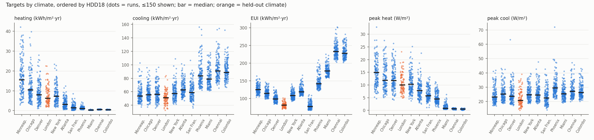
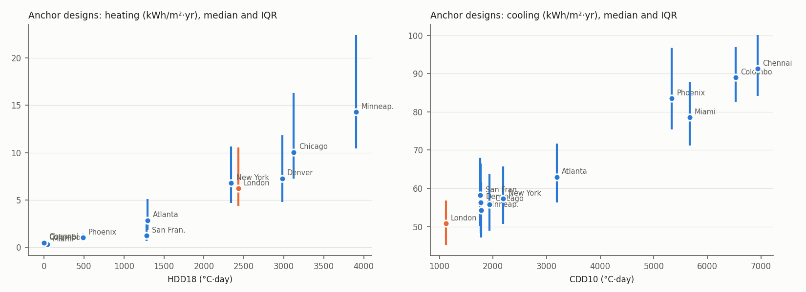
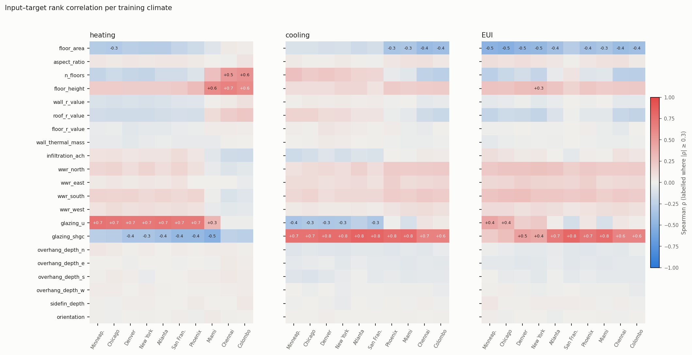
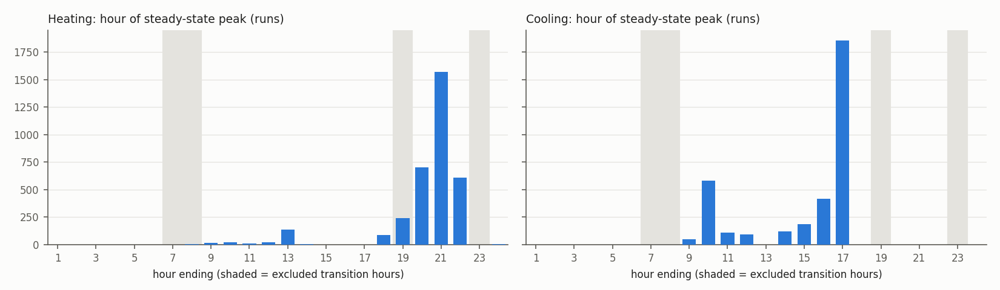

# Campaign QA report (Sub-task 2.6)

Generated 2026-10-13 17:33 by `runner/campaign_report.py` from `samples_main.csv` → `main/`, `samples_holdout.csv` → `holdout/`. Climates (by HDD18): minneapolis, chicago, denver, london, new_york, atlanta, san_francisco, phoenix, miami, chennai, colombo.

**Gate 2.6 → 2.7: GO**

| check | status |
|---|---|
| C. Completeness and target validity | **PASS** |
| A. Anchor integrity | **PASS** |
| R. Reliability (EnergyPlus messages) | **PASS** |
| P. Physics by climate | **PASS** |
| D. Direction of effects | **PASS** |
| H. Holdout coverage | **INFO** |
| K. Peak timing (Decision T4) | **PASS** |
| G. Ground coupling (Decision G1) | **PASS** |
| M. Meter gap, unmet hours, latent share | **INFO** |
| T. Runtime and disk | **INFO** |

## C. Completeness and target validity — PASS

| batch | climate | expected | ok | parsed | failed | build error | not run |
|---|---|---|---|---|---|---|---|
| holdout_id | minneapolis | 30 | 30 | 30 | 0 | 0 | 0 |
| holdout_id | chicago | 30 | 30 | 30 | 0 | 0 | 0 |
| holdout_id | denver | 30 | 30 | 30 | 0 | 0 | 0 |
| holdout_id | new_york | 30 | 30 | 30 | 0 | 0 | 0 |
| holdout_id | atlanta | 30 | 30 | 30 | 0 | 0 | 0 |
| holdout_id | san_francisco | 30 | 30 | 30 | 0 | 0 | 0 |
| holdout_id | phoenix | 30 | 30 | 30 | 0 | 0 | 0 |
| holdout_id | miami | 30 | 30 | 30 | 0 | 0 | 0 |
| holdout_id | chennai | 30 | 30 | 30 | 0 | 0 | 0 |
| holdout_id | colombo | 30 | 30 | 30 | 0 | 0 | 0 |
| holdout_ood | london | 100 | 100 | 100 | 0 | 0 | 0 |
| main | minneapolis | 300 | 300 | 300 | 0 | 0 | 0 |
| main | chicago | 300 | 300 | 300 | 0 | 0 | 0 |
| main | denver | 300 | 300 | 300 | 0 | 0 | 0 |
| main | new_york | 300 | 300 | 300 | 0 | 0 | 0 |
| main | atlanta | 300 | 300 | 300 | 0 | 0 | 0 |
| main | san_francisco | 300 | 300 | 300 | 0 | 0 | 0 |
| main | phoenix | 300 | 300 | 300 | 0 | 0 | 0 |
| main | miami | 300 | 300 | 300 | 0 | 0 | 0 |
| main | chennai | 300 | 300 | 300 | 0 | 0 | 0 |
| main | colombo | 300 | 300 | 300 | 0 | 0 | 0 |

Totals: holdout_id 300/300; holdout_ood 100/100; main 3000/3000; all 3400/3400 (100.0%).
Handoff floors: main ≥ 2,500, holdout ≥ 300 incl. ≥ 80 London — London parsed 100.

## A. Anchor integrity — PASS

- Anchor designs: 100; climates per anchor: 11–11
- Complete in every climate: **100/100**

## R. Reliability (EnergyPlus messages) — PASS

- .err files parsed: 3400; clean (no severe, only benign warnings): 3398
- Fatal: **0**; runs with severe errors: **2** (main_B0573_chicago, main_B0600_chicago)
- Runs that needed a retry: 0
- Baseline (pilot) message categories: unused_construction
- Reviewed and accepted (see `accepted_exceptions.csv`): main_B0573_chicago, main_B0600_chicago
- New benign category `outdoor_wetbulb_psychrometric` (reviewed, see err_parser): denver 330, new_york 330 runs

## P. Physics by climate — PASS

Anchor designs, across training climates (Spearman per design, then summarised):

| response | median ρ | min ρ | screen |
|---|---|---|---|
| heating vs HDD18 | +0.96 | +0.80 | median ≥ 0.9 |
| cooling vs CDD10 | +0.83 | +0.62 | median ≥ 0.8 |

minneapolis has the highest heating for 100% of 100 anchors.

- chennai (HDD18 = 0): heating < 2 kWh/m² in 100% of runs (median 0.55, max 0.84)
- colombo (HDD18 = 0): heating < 2 kWh/m² in 100% of runs (median 0.46, max 0.72)
- EUI within 50–300 kWh/m²: 99.9% of runs (range 65–305)

Median [p5–p95] per climate (climates ordered by HDD18; kWh/m²·yr, peaks W/m²):

| climate | n | heating | cooling | EUI | peak heat | peak cool |
|---|---|---|---|---|---|---|
| minneapolis | 330 | 15.5 [5.6–34.1] | 53.7 [40.8–75.8] | 124.8 [108.6–147.9] | 14.9 [7.8–25.1] | 23.1 [18.2–35.7] |
| chicago | 330 | 10.5 [3.9–24.1] | 55.5 [44.1–75.5] | 114.6 [102.6–138.2] | 11.9 [6.5–22.4] | 25.2 [19.5–37.3] |
| denver | 330 | 7.9 [2.2–19.6] | 56.1 [41.2–83.9] | 98.0 [85.8–118.8] | 11.8 [6.4–21.6] | 23.7 [18.4–35.7] |
| london | 100 | 6.2 [2.2–15.9] | 50.9 [36.4–66.1] | 80.7 [71.9–95.7] | 10.0 [5.5–17.4] | 20.7 [15.3–33.4] |
| new_york | 330 | 7.2 [2.4–16.5] | 57.2 [45.2–77.4] | 107.8 [96.4–125.9] | 10.3 [5.7–18.5] | 24.6 [19.4–35.3] |
| atlanta | 330 | 3.1 [0.9–8.3] | 62.6 [51.0–87.1] | 118.2 [108.0–142.0] | 7.8 [4.1–15.2] | 24.5 [19.9–35.8] |
| san_francisco | 330 | 1.4 [0.3–4.4] | 58.6 [44.5–84.8] | 76.5 [67.5–99.4] | 5.7 [3.2–10.7] | 22.4 [16.7–33.3] |
| phoenix | 330 | 1.1 [0.6–2.3] | 83.4 [66.1–126.9] | 141.5 [124.3–184.3] | 4.5 [2.3–8.8] | 29.4 [23.1–45.4] |
| miami | 330 | 0.3 [0.2–0.5] | 78.8 [64.1–108.6] | 177.9 [160.8–210.6] | 0.9 [0.5–3.2] | 25.4 [20.2–36.4] |
| chennai | 330 | 0.6 [0.4–0.7] | 90.8 [74.4–125.3] | 232.4 [211.7–274.4] | 0.6 [0.3–0.9] | 27.1 [21.7–39.2] |
| colombo | 330 | 0.5 [0.3–0.6] | 88.7 [72.4–119.3] | 227.8 [207.6–265.2] | 0.5 [0.3–0.7] | 26.2 [21.5–36.9] |

## D. Direction of effects — PASS

Spearman ρ per climate (n = 300–300). **Bold** = tier 1, required: expected sign and |ρ| ≥ 0.3 (FAIL). *Italic* = tier 2, weak effect: WARN only if the sign is significantly wrong (|ρ| ≥ 2 SE = 0.12, marked ✗); ✓ = expected sign and significant. Plain = not checked in that climate.

| target | input | exp. | minneapolis | chicago | denver | new_york | atlanta | san_francisco | phoenix | miami | chennai | colombo |
|---|---|---|---|---|---|---|---|---|---|---|---|---|
| cooling | shgc_x_wwr | + | **+0.76** | **+0.79** | **+0.79** | **+0.80** | **+0.87** | **+0.84** | **+0.86** | **+0.87** | **+0.76** | **+0.75** |
| peak cool | shgc_x_wwr | + | **+0.79** | **+0.73** | **+0.78** | **+0.75** | **+0.76** | **+0.81** | **+0.64** | **+0.76** | **+0.71** | **+0.73** |
| heating | glazing_u | + | **+0.74** | **+0.72** | **+0.71** | **+0.71** | **+0.73** | **+0.70** | **+0.70** | +0.33 | -0.02 | -0.02 |
| peak heat | glazing_u | + | **+0.57** | **+0.55** | **+0.47** | **+0.56** | **+0.54** | **+0.38** | **+0.33** | +0.67 | +0.17 | +0.05 |
| heating | wall_r_value | − | *-0.11* | *-0.12* ✓ | *-0.11* | *-0.12* ✓ | -0.11 | -0.09 | -0.08 | +0.01 | +0.03 | +0.09 |
| heating | roof_r_value | − | *-0.15* ✓ | *-0.16* ✓ | *-0.16* ✓ | *-0.16* ✓ | -0.15 | -0.13 | -0.14 | +0.11 | +0.20 | +0.24 |
| heating | infiltration_ach | + | *+0.08* | *+0.08* | *+0.06* | *+0.07* | +0.07 | +0.12 | +0.06 | -0.07 | -0.16 | -0.17 |
| cooling | mean_overhang | − | -0.13 | -0.13 | -0.09 | -0.12 | -0.05 | -0.10 | *-0.10* | *-0.12* ✓ | *-0.10* | *-0.10* |

## H. Holdout coverage — INFO

In-distribution holdout: share of runs inside the main batch's range for the same climate:

| target | inside |
|---|---|
| heating_demand_kwh_m2 | 99.0% |
| cooling_demand_kwh_m2 | 99.3% |
| eui_kwh_m2 | 99.0% |
| peak_heating_w_m2 | 98.7% |
| peak_cooling_w_m2 | 99.3% |
| zone_cooling_core_kwh_m2 | 98.0% |
| zone_cooling_south_kwh_m2 | 98.7% |
| zone_cooling_east_kwh_m2 | 99.7% |
| zone_cooling_north_kwh_m2 | 99.0% |
| zone_cooling_west_kwh_m2 | 99.7% |

Held-out climate **london** — climate features vs the training range:

| feature | training min | training max | london | position |
|---|---|---|---|---|
| hdd18 | 0 | 3903.3 | 2430.3 | inside |
| cdd10 | 1763.5 | 6940.6 | 1118.9 | **below** |
| annual_ghi | 1477.7 | 2140.1 | 1152.1 | **below** |
| mean_dbt | 8.932 | 29.015 | 11.541 | inside |
| mean_rh | 33.22 | 79.87 | 79.7 | inside |
| latitude | 6.9047 | 44.883 | 51.148 | **above** |
| mean_wind | 1.388 | 4.644 | 3.764 | inside |

A feature outside the training range makes this an extrapolation test for that feature; Phase 3 should report holdout accuracy with this caveat (RQ1).

london anchors: share of runs inside the same design's range over the training climates (output-space interpolation):

| target | inside | median |
|---|---|---|
| heating_demand_kwh_m2 | 100% | 6.2 |
| cooling_demand_kwh_m2 | 0% | 50.9 |
| eui_kwh_m2 | 63% | 80.7 |
| peak_heating_w_m2 | 100% | 10.0 |
| peak_cooling_w_m2 | 10% | 20.7 |
| zone_cooling_core_kwh_m2 | 16% | 50.2 |
| zone_cooling_south_kwh_m2 | 0% | 48.1 |
| zone_cooling_east_kwh_m2 | 0% | 55.2 |
| zone_cooling_north_kwh_m2 | 0% | 44.7 |
| zone_cooling_west_kwh_m2 | 0% | 35.8 |

## K. Peak timing (Decision T4) — PASS

Hour-of-day (hour ending) of the steady-state peaks. Excluded transition hours: 07, 08, 23 (Mon–Fri); 07, 08, 19 (Sat). A cluster at hour 09 would mean recovery lasts > 2 h.

| peak | 01 | 02 | 03 | 04 | 05 | 06 | 07 | 08 | 09 | 10 | 11 | 12 | 13 | 14 | 15 | 16 | 17 | 18 | 19 | 20 | 21 | 22 | 23 | 24 |
|---|---|---|---|---|---|---|---|---|---|---|---|---|---|---|---|---|---|---|---|---|---|---|---|---|
| heat |  |  |  |  |  |  |  | 4 | 12 | 17 | 9 | 17 | 134 | 2 |  |  |  | 83 | 241 | 700 | 1571 | 608 |  | 2 |

Heating steady peaks at hour 09: 0% of runs; ratio steady/hourly peak there median 0.22.
| cool |  |  |  |  |  |  |  |  | 45 | 580 | 108 | 90 |  | 117 | 186 | 417 | 1857 |  |  |  |  |  |  |  |

## G. Ground coupling (Decision G1) — PASS

- chennai: heating vs floor insulation ρ = **+0.03**, max heating 0.84 kWh/m²
- colombo: heating vs floor insulation ρ = **+0.02**, max heating 0.72 kWh/m²

FAIL when ρ < −0.5 and heating > 2 kWh/m² (slab losing heat to a ground that is too cold; the pre-G1 symptom).

## M. Meter gap, unmet hours, latent share — INFO

Zone sensible minus EnergyTransfer meter, % of zone sensible (runs with > 0.5 kWh/m²):

| climate | heating mean | cooling mean | latent share of cooling (median) | max unmet h (heat / cool) |
|---|---|---|---|---|
| minneapolis | 1.7% | 0.10% | 12% | 0.0 / 0.0 |
| chicago | 2.0% | 0.11% | 12% | 0.0 / 0.0 |
| denver | 2.0% | 0.07% | 11% | 0.0 / 0.2 |
| london | 2.2% | 0.08% | 12% | 0.0 / 0.0 |
| new_york | 2.4% | 0.12% | 12% | 0.0 / 0.0 |
| atlanta | 2.8% | 0.13% | 13% | 0.0 / 0.0 |
| san_francisco | 2.3% | 0.04% | 11% | 0.0 / 0.0 |
| phoenix | 2.9% | 0.17% | 9% | 0.0 / 0.0 |
| miami | 5.2% | 0.24% | 16% | 0.0 / 0.0 |
| chennai | 5.6% | 0.30% | 17% | 0.0 / 0.0 |
| colombo | 7.0% | 0.32% | 17% | 0.0 / 0.0 |

## T. Runtime and disk — INFO

| batch | runs on disk | GB | MB/run | EnergyPlus s/run (median / p90 / max) | wall h | s/run throughput |
|---|---|---|---|---|---|---|
| main | 3000 | 3.80 | 1.27 | 16.2 / 28.0 / 57.8 | 1.91 | 2.3 |
| holdout | 400 | 0.51 | 1.27 | 24.3 / 41.7 / 68.6 | 0.36 | 3.3 |

## Figures

