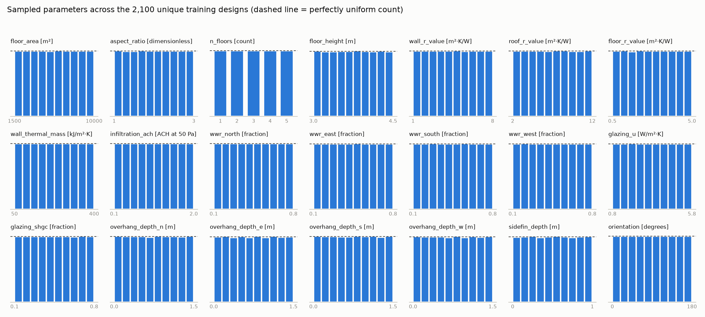
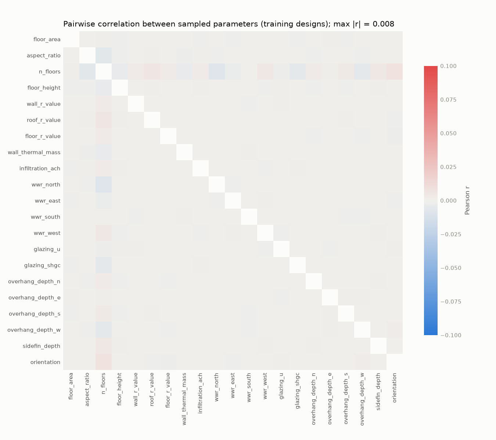

# Sub-task 2.4 — Sampling report

Generated by `python sampling/sampler.py --report` from the sample files. Do not edit by hand.

Master seed `20261001` · design_space.yaml `13cf8ed0f25f` · climate_config.yaml `e4a12868de11`

## 1. Runs

| File | Batch | Runs | Unique designs | Climates |
|---|---|---|---|---|
| `samples_main.csv` | main | 3,000 | 2,100 | 10 |
| `samples_holdout.csv` | holdout_id | 300 | 300 | 10 |
| `samples_holdout.csv` | holdout_ood | 100 | 100 | 1 |
| `samples_pilot.csv` | pilot | 200 | 50 | 4 |
| | **campaign (main + holdout)** | **3,400** | | |

Each training climate sees 100 anchors + 200 climate-specific designs; 2,100 unique buildings across the training set.

## 2. Space-filling quality

Normalised parameter space (21 dimensions, each scaled to [0, 1]). Lower discrepancy = more uniform. Every set below is a Latin hypercube (B and C also per climate slice) — checked by the test suite.

| Set | Designs | Centred L2 discrepancy | Max \|r\| between parameters | Nearest-neighbour distance (min / median) |
|---|---|---|---|---|
| A anchors | 100 | 0.8152 | 0.032 (floor_area × n_floors) | 0.931 / 1.368 |
| B specific | 2,000 | 0.0799 | 0.009 (wwr_north × n_floors) | 0.666 / 1.061 |
| A+B training | 2,100 | 0.0780 | 0.008 (n_floors × wwr_north) | 0.666 / 1.059 |
| C holdout_id | 300 | 0.2882 | 0.024 (overhang_depth_s × n_floors) | 0.925 / 1.214 |
| P pilot LHS | 42 | 1.7986 | 0.071 (aspect_ratio × n_floors) | 1.313 / 1.505 |

Chosen candidates (best of 50 by discrepancy): A #26, B #43, C #24, P #9.

Chance correlation between parameters was then removed by within-slice value swaps that keep every Latin-hypercube property (`lhs.decorrelate`). Largest |r| over the whole set and every climate slice, before → after:

| Set | Before | After |
|---|---|---|
| A (anchor) | 0.301 | 0.002 |
| B (specific) | 0.239 | 0.009 |
| C (holdout) | 0.625 | 0.066 |
| P (pilot_lhs) | 0.538 | 0.008 |

## 3. Holdout placement

Distance from each in-distribution holdout design to its nearest training design, compared with the training set's own nearest-neighbour spacing:

| | min | median | max |
|---|---|---|---|
| holdout_id → nearest training design | 0.822 | 1.066 | 1.267 |
| training → nearest other training design | 0.666 | 1.059 | 1.370 |

No holdout design coincides with a training design (minimum distance > 0). Similar spacing means the holdout tests interpolation between training designs at the density the surrogate will meet in use. The out-of-distribution batch (London) reuses the anchor designs by design (Decision S4): only the climate is unseen.

## 4. Number of floors (Decision S3)

| Set | 1 | 2 | 3 | 4 | 5 |
|---|---|---|---|---|---|
| A anchors | 20 | 20 | 20 | 20 | 20 |
| B specific | 400 | 400 | 400 | 400 | 400 |
| A+B training | 420 | 420 | 420 | 420 | 420 |
| C holdout_id | 60 | 60 | 60 | 60 | 60 |
| P pilot LHS | 9 | 8 | 9 | 8 | 8 |

## 5. Pilot edge cases

Each runs in every pilot climate (colombo, phoenix, san_francisco, minneapolis).

| ID | Stresses |
|---|---|
| E01 | every parameter at its minimum |
| E02 | every parameter at its maximum |
| E03 | most slender: smallest footprint, aspect 3, 5 tall floors (narrowest core) |
| E04 | largest: biggest square footprint, 5 floors |
| E05 | single storey (roof and ground coupling dominate) |
| E06 | max glazing + deepest overhangs and fins at the lowest floor height |
| E07 | min glazing, no shading |
| E08 | reference: every parameter mid-range |

## 6. Pre-flight (build_idf on every unique design)

**2,450 / 2,450 designs built** (0 failed) against `IDD_Version 24.1.0` IDD; mean build time 0.568 s. Each IDF was also checked for 5 zones and 4 windows per floor.

## 7. Figures

## 8. Notes for later phases

- **Model inputs:** the 21 sampled parameters (`manifest.parameters.model_inputs`) + 7 climate features joined in 2.7. `glazing_vt` is a copy of `glazing_shgc` (Decision S2) and must not be a model input.
- **Phase 3 splits:** anchors appear in 10 climates. Use GroupKFold on `design_id`; a row-wise split would put the same building in train and test.
- **2.5 pilot:** also run one VT-only pair (identical IDFs, VT changed) to confirm VT has no effect on the targets (justification for S2).
